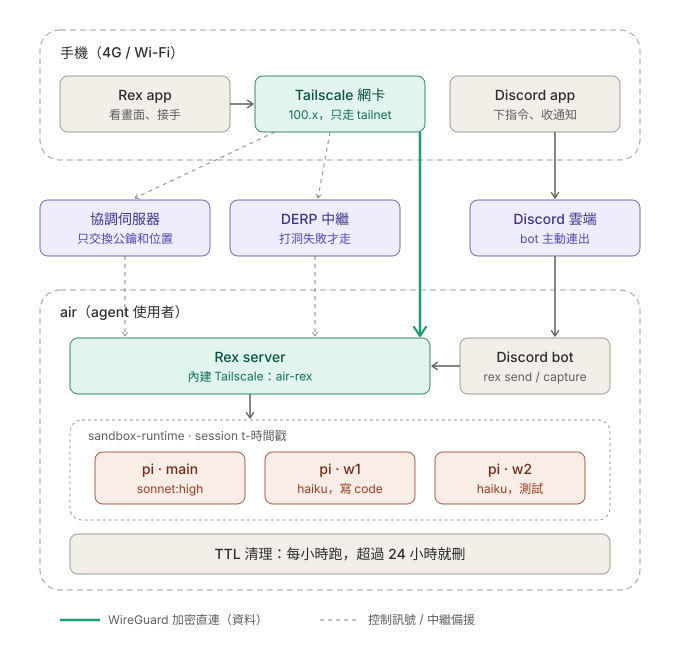

# ADR-0001：用一台 air 當 AI agent home lab

- **狀態**：提議中（Proposed）
- **日期**：2026-11-27
- **決策者**：@louis70109

## 背景

我想要一個能從手機遠端控制、可以長時間跑 AI coding agent 的 home lab，用來做本地開發。

現有的資源和限制：

- **硬體**：一台 Intel MacBook Air（以下稱 air），一台 Windows 筆電
- **網路**：已經在用 Tailscale；家裡的路由器不想對外開 port
- **工具**：[Rex](https://superlogical.com)（Superlogical 做的終端機 multiplexer，還在 beta，內建 Tailscale，可以用 CLI 控制 session），以及 [pi coding agent](https://pi.dev)
- **操作方式**：想從 Discord bot 下指令
- **要求**：agent 必須在 sandbox 裡跑；所有資源存在超過 24 小時就自動刪除

兩台筆電都只有 CPU 等級的算力，把它們組成叢集來跑模型的效益很低。模型的推論一律交給雲端 API。

## 決策

只用 air 一台當 server。在 air 上用 Rex 跑幾個關在 sandbox 裡的 pi agent，不同角色的 agent 用不同的雲端模型。整套系統透過 Tailscale 和 Discord 遠端控制，所有資源套用 24 小時的 TTL。Windows 先當客戶端用。

| 元件 | 做法 |
| --- | --- |
| 執行環境 | 在 air 上開一個專用的 `agent` 使用者。關掉睡眠，打開停電後自動開機（`pmset autorestart 1`）和自動登入 |
| Session 管理 | 執行 Rex server，打開內建的 Tailscale（hostname 設成 `air-rex`）。每個任務開一個 session，命名為 `t-<epoch>` |
| Agent | pi 分成兩種角色。`main` 負責指揮，用強模型（例如 `--model sonnet:high`）；`w1`、`w2` 負責執行，用便宜的模型。`main` 用 `rex split` 開出子 agent |
| 模型計費 | 一律用 API key，按用量計費。不把 Claude Pro/Max 訂閱的 OAuth 用在 pi 這類第三方 harness 上 |
| 隔離 | 用 `@anthropic-ai/sandbox-runtime`（macOS 上走 Seatbelt）。只能寫入任務資料夾；網路只開放模型 API 和 GitHub |
| 遠端控制 | Discord bot 跟 Rex 跑在同一台 air 上，直接在本機呼叫 `rex send`、`rex capture`、`rex events`。只接受白名單裡的 Discord ID |
| TTL | 由 launchd 每小時執行 `ttl-cleanup.sh`，刪除存在超過 24 小時的任務資料夾、Rex session、暫存檔和 pi 對話紀錄 |
| 保留成果 | 任務結束前，agent 要 commit 並 push 到 `agent/<日期>` branch |

## 架構

- **綠色粗線**：手機的 Rex app 經過 Tailscale 網卡，用 WireGuard 直接連到 `air-rex`
- **虛線**：Tailscale 自己的機制。協調伺服器只負責交換公鑰和位置；NAT 穿透失敗時，改走 DERP 中繼
- **Discord 不經過 tailnet**：bot 從 air 主動連到 Discord，所以路由器上完全不用開 port

## 考慮過的其他方案

| 方案 | 不選的原因 |
| --- | --- |
| air + Windows 組成叢集一起算 | Rex 不負責分配算力；模型都在雲端，本機的算力用不上 |
| air 和 Windows 分工，各跑一部分任務 | macOS 和 WSL2 的環境不一致，交接成本也高。之後如果加 Windows，只交給它無狀態的 build 或測試工作 |
| SSH + tmux | 要自己管 SSH key 和 sshd。沒有 agent 狀態顯示，手機上也不好操作 |
| 遠端桌面 | 吃頻寬，在 Intel Air 上也太吃資源；而且沒辦法寫腳本控制 |
| 直接開 port 或用 ngrok | 等於把 shell 暴露在網路上，還要自己做驗證 |
| 讓 pi 用訂閱帳號登入 | Anthropic 的條款限制在第三方 harness 使用訂閱的 OAuth |

## 後果

**好處**

- 只要維護一台機器，環境一致，沒有交接問題
- 路由器不開任何 port，只有 tailnet 裡的裝置連得到
- agent 在背景一直跑，手機、Windows、Discord 都能接手
- 用不同等級的模型分工，可以壓低 API 費用
- 有 TTL，就不會累積殘留的機密、磁碟用量和被遺忘的 agent

**壞處和風險**

| 風險 | 對策 |
| --- | --- |
| API 費用失控 | 在各家供應商設定 spending limit；子 agent 用便宜的模型；bot 限制每天的任務數 |
| Rex 還在 beta，指令可能會變 | 所有 rex 指令集中寫在 bot 的同一個模組裡；另外保留 macOS SSH 當備援的登入方式 |
| Intel Air 過熱或效能不夠 | 同時最多 3 個 pi；比較重的工作之後再交給 Windows |
| Discord 帳號被盜 = 遠端 shell 被拿走 | 打開 2FA；bot 用白名單；危險的指令要二次確認 |
| air 單點故障 | 用健康檢查（dead man's switch）通知；設定檔放在這個 repo，壞掉時可以快速重建 |
| 成果被 TTL 刪掉 | 強制 push 到 branch；到期前 1 小時在 Discord 提醒 |

## 實作階段

- [ ] 階段 1：air 的基礎環境（`agent` 使用者、關掉睡眠、Rex 加上 Tailscale）
- [ ] 階段 2：pi + sandbox-runtime
- [ ] 階段 3：Discord bot 基本版（`!new` `!pi` `!look` `!stop` `!list`）
- [ ] 階段 4：TTL 清理 + push 成果
- [ ] 階段 5：用 `rex events` 主動推播通知；寫一個 pi extension 回報 OSC 7501 狀態
- [ ] 階段 6：`rex-subagent` pi skill，讓 main 能開子 agent
- [ ] 階段 7（選擇性）：在 Windows 的 WSL2 裡跑 Docker，接收無狀態的工作

**Home lab 補強項目**

- [ ] Tailscale ACL：只開放手機和 Windows 連到 `air-rex:443`；關掉 air 的 key expiry
- [ ] 打開 macOS 遠端登入，而且只限 tailnet 連入，當作備援
- [ ] 健康檢查回報到 Discord
- [ ] 機密放進鑰匙圈，或權限設成 600 的 `.env`
- [ ] 電池充電上限設成 80%
- [ ] 把 launchd plist、腳本、pi skill 放進這個 repo
